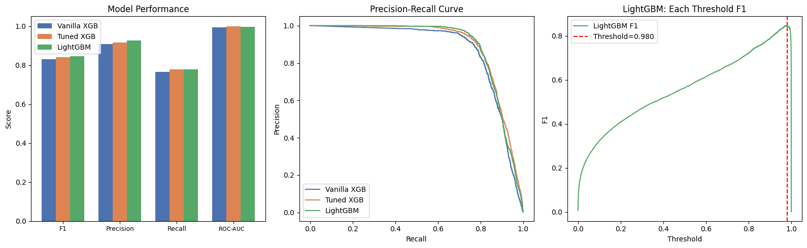
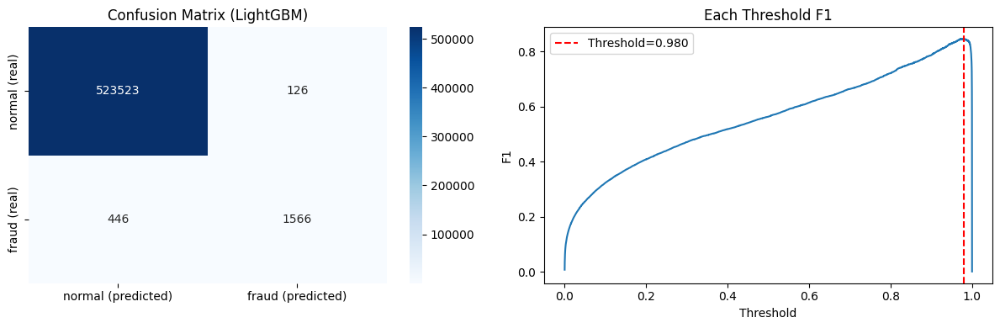
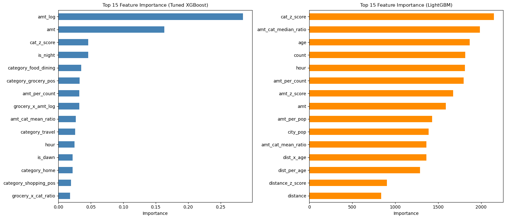

# Credit Card Fraud Detection — XGBoost vs LightGBM

Gradient-boosted models for detecting fraudulent card transactions in a highly imbalanced dataset
(**0.52% fraud** across 1.85M transactions), with a **time-based train/test split**, engineered
amount/time/interaction features, class weighting and decision-threshold optimisation.

**Result:** LightGBM reaches **F1 = 0.846** on the hold-out period (precision 0.926, recall 0.778),
up from F1 = 0.69 for an earlier Random Forest + oversampling baseline and from F1 = 0.48 for
XGBoost at the default 0.5 threshold.



## Problem

Fraud is rare, so accuracy is meaningless (predicting "never fraud" scores 99.5%). The models are
compared on **F1, precision and recall for the fraud class**, and the decision threshold is tuned
instead of using 0.5.

## Data

Kaggle — [Credit Card Transactions Fraud Detection Dataset](https://www.kaggle.com/datasets/kartik2112/fraud-detection)
(simulated with Sparkov; 1,000 customers, 800 merchants, Jan 2019 – Dec 2020). The notebooks use a
preprocessed pickle with 23 columns (amount, z-scores, distance, age, one-hot category and gender).
It is too large for GitHub — see [`data/README.md`](data/README.md) for the schema and where to place it.

| | Rows | Fraud rate |
|---|---:|---:|
| Train (before 2020-07-01) | 1,326,733 | 0.576% |
| Test (2020-07-01 onwards) | 525,661 | 0.383% |

## Approach

1. **Feature engineering** (23 → 40 model features)
   - amount relative to its category mean/median, `log(amount)`
   - time: hour, weekday, dawn/night/weekend flags, 02–04h "peak fraud" flag
   - interactions: grocery-POS × amount, distance × age, amount per transaction count and per city population
   - missing-value flag for `cat_z_score`
2. **Time-based split** — train on the past, test on the future, so no future information leaks into training.
3. **Imbalance handling** — `scale_pos_weight = 172.7` (XGBoost) and `is_unbalance=True` (LightGBM) instead of SMOTE, avoiding synthetic samples on 1.3M rows.
4. **Threshold optimisation** — pick the threshold that maximises F1 on the precision–recall curve.

## Results (hold-out period, F1-optimal threshold)

| Model | F1 | Precision | Recall | ROC-AUC | Threshold |
|---|---:|---:|---:|---:|---:|
| Vanilla XGBoost | 0.830 | 0.908 | 0.764 | 0.995 | 0.575 |
| Tuned XGBoost | 0.841 | 0.917 | 0.777 | 0.998 | 0.983 |
| **LightGBM** | **0.846** | **0.926** | **0.778** | 0.997 | 0.980 |

- LightGBM catches **1,566 of 2,012** fraudulent transactions with only **126 false alarms** among 523,649 legitimate ones.
- PR-AUC (average precision) of the tuned XGBoost is ≈ 0.89 — a more informative ranking metric than ROC-AUC at this level of imbalance.
- Threshold tuning matters most: tuned XGBoost goes from **F1 0.48 at 0.5 → 0.84 at 0.98** (notebook 02).




## Limitations

- **Optimistic hold-out scores.** Early stopping and threshold selection were done on the same hold-out window that is used for reporting. A stricter protocol would reserve a validation window inside the training period (e.g. Apr–Jun 2020). Expect slightly lower scores on truly unseen data.
- **Simulated data.** Sparkov transactions are synthetic; real fraud patterns drift and are noisier.
- **Metric label fix.** In the original run the ROC-AUC column was mislabelled "AUC-PR". Code and printed output are corrected; the embedded chart in notebook 01 still shows the old label (a note is added next to it).
- The notebooks keep the outputs of the original Colab run. Since then, only non-functional edits were made (data path handling, metric labels, a Korean font fallback for plots, and a NumPy-2-compatible way of rebuilding the category label), and both notebooks were re-executed end to end on synthetic data of the same schema to check they run.

## Repository structure

```
notebooks/
  01_model_comparison_xgboost_lightgbm.ipynb   # main pipeline: features, 3 models, comparison, final model
  02_xgboost_threshold_optimization.ipynb      # XGBoost + scale_pos_weight, threshold tuning (0.5 vs optimal)
figures/                                       # charts exported from the notebooks
data/README.md                                 # dataset source and expected schema
requirements.txt
```

Notebook text and comments are in Korean (course project); this README summarises them in English.

## How to run

```bash
pip install -r requirements.txt
# place fraud_data.pkl in data/ (see data/README.md)
jupyter notebook notebooks/01_model_comparison_xgboost_lightgbm.ipynb
```

Training on the full 1.3M-row training set takes a few minutes per model on a laptop CPU.

## Tech stack

Python · pandas · NumPy · scikit-learn · XGBoost · LightGBM · Matplotlib · Seaborn
